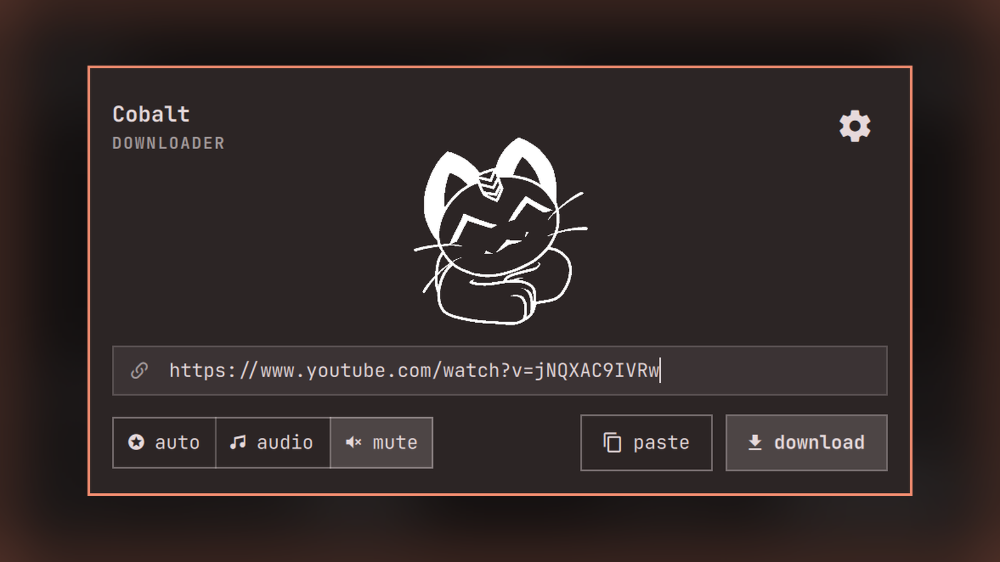
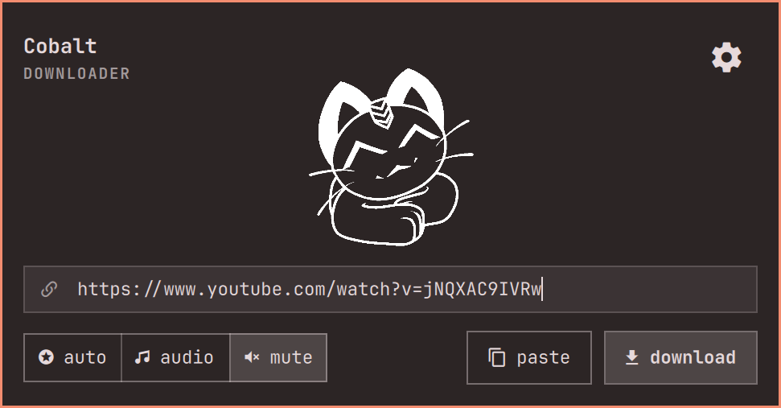
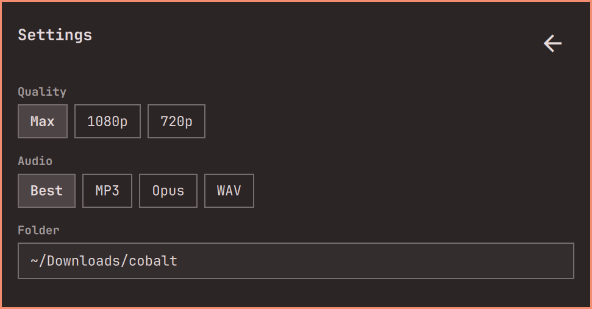

<h1 align="center">Cobalt Download</h1>
<p align="center">Paste a YouTube, TikTok or X link, save the file. An unofficial <a href="https://omarchy.org">Omarchy</a> bar panel.</p>

<p align="center"></p>

## Install

```sh
omarchy pkg add yt-dlp ffmpeg
omarchy plugin add https://github.com/CloudDown/omarchy-cobalt.git --enable
```

Remove: `omarchy plugin remove clouddown.cobalt` (keeps `~/.config/omarchy/cobalt.json`).

<table>
  <tr>
    <td width="50%" align="center"><br /><sub>Paste a link, pick auto / audio / mute</sub></td>
    <td width="50%" align="center"><br /><sub>Quality, audio format, folder</sub></td>
  </tr>
</table>

## Usage

Click the bar icon → **paste** a URL → **auto** / **audio** / **mute** → **download** → **open**.
Cobalt API first, **yt-dlp** if the instance can't fetch the link.

```sh
omarchy bar move clouddown.cobalt --section right   # move the icon
omarchy-shell shell toggle clouddown.cobalt         # open / close the panel
```

<p align="center"><a href="docs/GUIDE.md">Docs</a> · MIT · Not affiliated with <a href="https://cobalt.tools">cobalt.tools</a>. You are responsible for what you download.</p>
